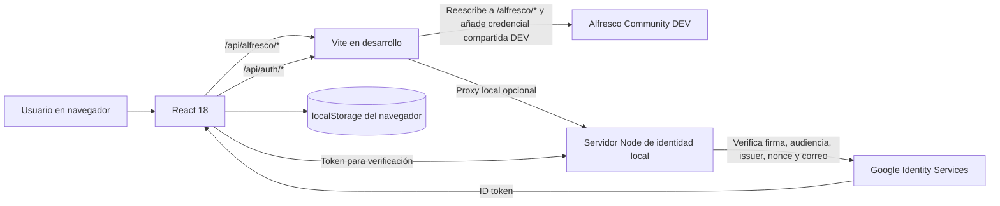
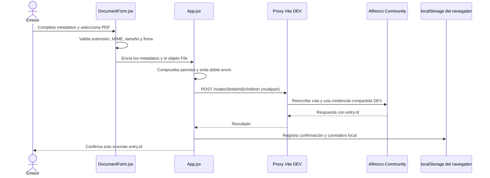

# Estado técnico-funcional del proyecto

**Sistema de Gestión Documental Interna — Universidad Andina del Cusco (UAC)**  
**Fecha de elaboración:** 10 de noviembre de 2026  
**Rama revisada:** `rama-diego-1` (`75bd6df`, sincronizada con `origin/rama-diego-1` al momento de la revisión)

## Resumen ejecutivo

El repositorio contiene una aplicación frontend en React 18 y Vite 5 para un piloto documental con perfiles de demostración DTI y DSA. La aplicación tiene un dashboard único parametrizado para Director, un formulario que valida PDF y una integración de desarrollo con Alfresco Community mediante el proxy del servidor Vite.

La carga real de PDF está implementada en el código, pero no se encontró evidencia de una prueba de envío `POST` en esta revisión. La consulta de la carpeta compartida DEV sí fue comprobada a través del proxy local: respondió HTTP 200 con cuatro archivos que cumplen los criterios de nombre y MIME usados para candidatos PDF. La interfaz ofrece la sección **Bandeja de pruebas de Alfresco** únicamente en desarrollo; no presenta esa carpeta como privada de DTI o DSA.

El piloto todavía no dispone de autenticación institucional ni de autorización individual para Alfresco. La verificación Google local solo confirma una identidad; no asigna rol o dependencia. Los estados de atención y el destinatario de cada documento no están disponibles en el mapeo consultado, por lo que las bandejas por dependencia y las notificaciones reales no pueden considerarse implementadas. Los correlativos y varios registros se conservan en `localStorage`, sin coordinación entre navegadores o usuarios.

Este documento describe el código revisado, no una propuesta futura presentada como funcionalidad existente. No se consultaron ni incorporaron valores de `.env.local`, credenciales, tokens, nombres de los documentos de prueba o identificadores de nodos.

## 1. Información general

### 1.1 Nombre y objetivo

El proyecto se identifica como **Sistema de Gestión Documental Interna de la Universidad Andina del Cusco**. Su objetivo actual es prototipar una interfaz administrativa para registrar documentos, enviarlos a una carpeta de pruebas de Alfresco y preparar pantallas por rol y dependencia.

### 1.2 Alcance del piloto

- Dependencias de prueba: Dirección de Tecnologías de Información (DTI) y Dirección de Servicios Académicos (DSA).
- La identidad DTI y el perfil DSA son datos de demostración definidos en `src/data/simulatedSession.js`; no son un directorio de usuarios institucionales.
- La carga y consulta de documentos se dirigen a Alfresco DEV por una carpeta configurada. La carpeta de prueba es compartida y no representa una bandeja privada de una dependencia.
- No hay backend institucional de documentos, flujo de aprobación, gestión real de usuarios ni modelo persistente de atención.
- Los datos que se guardan en `localStorage` son locales al navegador.

### 1.3 Dependencias técnicas

| Tecnología | Versión declarada o resuelta | Uso |
|---|---:|---|
| React | 18.3.1 | Componentes e interfaz. |
| React DOM | 18.3.1 | Renderizado de la aplicación. |
| Vite | `^5.4.10` (la compilación revisada resolvió 5.4.21) | Servidor de desarrollo, proxy y compilación. |
| JavaScript | ES modules | Lógica de cliente y servidor local de identidad. |
| `google-auth-library` | `^11.3.4` | Verificación local de ID tokens de Google. |

No se utiliza React Router ni una biblioteca adicional de componentes. La navegación se controla con estado React.

## 2. Arquitectura técnica

### 2.1 Estructura relevante

| Ruta | Responsabilidad actual |
|---|---|
| `src/App.jsx` | Sesión de interfaz, panel activo, rol, menú, permisos de Alfresco, envío y composición del dashboard. |
| `src/api/alfresco.js` | Consultas Core/Search, descarga del contenido y creación de PDF en Alfresco. |
| `src/auth/session.js` | Normalización de identidad y creación de la sesión de demostración. |
| `server/index.js` | Servidor local opcional para verificación de identidad Google y sesión temporal en memoria. |
| `src/config/roles.js` | Definiciones de roles y menús; contiene la opción DEV marcada como `devOnly`. |
| `src/data/` | Perfiles, catálogo documental y asignaciones/notificaciones de demostración. |
| `src/components/` | Formularios, navegación, listas, selector buscable, campanita y visor PDF. |
| `src/hooks/useAlfrescoInbox.js` | Consulta, estados de carga/error, actualización y filtrado de documentos del inbox. |
| `src/pages/` | Panel único de Director y páginas para otros roles. |
| `src/utils/documentStore.js` | Correlativos y documentos locales o confirmados por Alfresco. |
| `src/utils/notificationStore.js` | Persistencia local de notificaciones de demostración. |
| `src/utils/organizationalStore.js` | Persistencia local de jerarquía de demostración. |
| `vite.config.js` | Proxy de desarrollo para autenticación local y Alfresco. |

### 2.2 Navegación y composición

`src/App.jsx` selecciona la página a partir del rol y del identificador del panel. `src/pages/index.js` asocia cada rol con su componente. No hay rutas URL independientes para cada panel.

El rol Director usa `DirectorWorkspacePage` tanto para DTI como para DSA. Los datos de usuario/dependencia se pasan como propiedades; no hay un dashboard duplicado por dependencia. La barra lateral desplegable y la barra superior están en `src/components/Sidebar.jsx` y `src/components/TopBar.jsx`.

En `import.meta.env.DEV`, el menú del Director añade **Bandeja de pruebas de Alfresco**. Esta opción hace una consulta genérica a la carpeta compartida; no aplica ni simula permisos de una dependencia.

### 2.3 Diagrama de arquitectura

Vite es un proxy de desarrollo, no un backend institucional ni un punto de autorización por usuario. `server/index.js` solo administra verificación Google de desarrollo y sesiones en memoria; no implementa operaciones documentales.

### 2.4 Variables de configuración

Se indican nombres y finalidad según su uso en el código; no se registran valores:

| Variable | Finalidad |
|---|---|
| `VITE_ALFRESCO_CORE_API_PREFIX` | Prefijo Core API usado por el navegador para nodos, contenido, grupos y permisos. Es una variable `VITE_`, por tanto su valor queda disponible en el bundle. |
| `VITE_ALFRESCO_SEARCH_API_PREFIX` | Prefijo Search API usado por `searchDocuments()`. |
| `VITE_ALFRESCO_INBOX_NODE_ID` | Identificador de la carpeta de pruebas; se utiliza para consultar y crear contenido en esa carpeta. No es una contraseña, pero revela una referencia interna y no debe tratarse como autorización. |
| `ALFRESCO_TARGET` | Destino upstream del proxy Vite para Alfresco. |
| `ALFRESCO_USERNAME`, `ALFRESCO_PASSWORD` | Credenciales compartidas que Vite adjunta al proxy de desarrollo; no tienen prefijo `VITE_`. |
| `AUTH_TARGET` | Destino del proxy local `/api/auth`. |
| `GOOGLE_CLIENT_ID` | Client ID público utilizado por Google Identity Services y por el servidor local para validar audiencia. |
| `GOOGLE_ALLOWED_HOSTED_DOMAIN` | Restricción opcional de dominio Workspace en el servidor local. |
| `APP_ORIGIN` | Origen permitido para operaciones del servidor de identidad local. |
| `AUTH_HOST`, `AUTH_PORT` | Dirección y puerto del servidor local de identidad; el host por defecto es loopback. |

`.env.local` está cubierto por `.gitignore` (`.env.*`) y no aparece como archivo rastreado en el índice actual. Esta comprobación no sustituye una revisión histórica de secretos publicados en otros repositorios o servicios.

## 3. Interfaces desarrolladas

| Interfaz | Objetivo y componentes | Fuente de datos | Limitaciones |
|---|---|---|---|
| Login | `LoginPage.jsx` muestra identidad UAC, botón GIS cuando está configurado y acceso de demostración DTI/DSA. | Google Identity Services o `createDemoSession()`. | El acceso de demostración no autentica. Google solo confirma identidad y no habilita dashboard, rol o Alfresco. |
| Dashboard Director | `DirectorWorkspacePage.jsx`, compartido entre DTI y DSA; muestra indicadores y actividad reciente. | `documents` locales de demostración. | No es un resumen de actividad en tiempo real de Alfresco. |
| Barra lateral | `Sidebar.jsx`: colapsable, perfil, cambio de función, navegación y cierre de sesión. | Sesión React y `roles.js`. | El perfil no edita la identidad institucional. Los roles visuales no constituyen permisos backend. |
| Barra superior | `TopBar.jsx`: dependencia y campanita. | Perfil actual y arreglo de notificaciones entregado por App. | No hay conexión de la campanita con un flujo persistente de Alfresco. |
| Perfil | Datos de nombre, cargo y oficina en el sidebar; selector de función y botón de salida. | Perfil simulado/local. | No actualiza datos de ERP ni administra correo o contraseña. |
| Notificaciones | `NotificationBell.jsx` permite abrir y cerrar el panel; en demostración permite retirar elementos. | `simulatedNotifications.js` y `notificationStore.js`. | La persistencia es `localStorage`; no representa pendientes reales ni navegación a una tarea Alfresco. |
| Nuevo documento | `DocumentForm.jsx` organiza destinatario, identificación, remitente, información y PDF principal. | `emisorCatalog.js`, perfil simulado y correlativos locales. | La dependencia habilitada actualmente es DSA; anexos deshabilitados. Envío se restringe por `allowAlfrescoUpload`. |
| Documentos enviados | Tabla y visor desde `DirectorWorkspacePage.jsx`. | Confirmaciones con `entry.id` conservadas en `localStorage`. | No se reconstruye el historial completo desde Alfresco al cambiar de navegador o limpiar almacenamiento. |
| Para conocimiento | `DirectorPage.jsx` usa el hook de inbox y permite actualizar/seleccionar PDF cuando la sesión tiene permiso de lectura. | Alfresco, filtrado por `destinationId`. | `nodeToDocument()` no provee destinatario; no permite clasificar actualmente por DTI/DSA. La autorización de sesión real todavía no existe. |
| Bandeja de pruebas de Alfresco | Opción DEV del Director, `DirectorPage.jsx`, `DocumentList.jsx` y `PdfPreview.jsx`. | Hijos reales de `VITE_ALFRESCO_INBOX_NODE_ID`. | Carpeta genérica compartida; no privada ni atribuida a una dependencia. Filtra candidatos por extensión y MIME, y el visor valida firma al seleccionar. |
| Gestión de jerarquía | `HierarchyManagementPage.jsx` agrega personas y unidades localmente. | `organizationalStore.js` y `localStorage`. | No crea cuentas, asignaciones reales ni permisos Alfresco. |
| Jefe de unidad | `JefeUnidadPage.jsx`. | Props de panel. | Pantalla genérica; no hay flujo propio implementado. |
| Especialista | `EspecialistaPage.jsx`; lista asignaciones cuando se selecciona el panel correspondiente. | Documentos locales entregados desde App. | No existe asignación persistente desde Alfresco ni acciones de derivación/cierre. |
| Colaborador y Técnico | `ColaboradorPage.jsx` y `TecnicoPage.jsx`. | Props de panel. | Pantallas base; los flujos documentales y pruebas técnicas anunciadas en el menú siguen pendientes. |

El repositorio conserva además páginas como `EmisorPage.jsx`, `RevisionPage.jsx`, `ReportesPage.jsx`, `RecepcionPage.jsx` y `ArchivoPage.jsx`. No todas están conectadas al mapa de páginas activo en `src/pages/index.js`.

## 4. Gestión documental

### 4.1 Formulario y datos

`DocumentForm.jsx` incluye:

- Dependencia destinataria buscable; DSA es la opción disponible del catálogo de demostración.
- Unidad y puesto de Dirección DSA mostrados como valores fijos de la prueba.
- Tipo documental (Oficio, Memorando, Informe, Solicitud y Carta) y prioridad (Normal, Alta, Urgente), ambos definidos como catálogos provisionales.
- Correlativo anterior y siguiente, año, sigla de emisor, vista previa del número documental.
- Remitente, cargo y oficina de origen procedentes del perfil simulado DTI.
- Asunto, fecha de emisión asignada al confirmar, prioridad y descripción.
- PDF principal requerido; la sección de anexos indica expresamente que su carga no está habilitada.

El correlativo se calcula en `src/utils/documentStore.js` por sigla emisora, tipo documental y año. Se inicia desde `0000` y el siguiente se muestra como `0001`. Se persiste en el navegador y se actualiza después de la confirmación de Alfresco. No ofrece exclusión mutua entre usuarios, navegadores o dispositivos.

### 4.2 Validación y vista previa

El formulario comprueba extensión `.pdf`, MIME cuando el navegador lo proporciona, tamaño no vacío y límite de 20 MiB, y firma `%PDF-`. `uploadPdfToFolder()` vuelve a comprobar extensión, MIME y firma antes de enviar.

`PdfPreview.jsx` obtiene el contenido como Blob, comprueba nombre, MIME permitido y firma PDF, crea una URL temporal de objeto y la revoca al cambiar/cerrar el contenido. Incluye descargar y abrir en otra pestaña. El `iframe` usa la URL Blob del PDF validado y no incluye atributo `sandbox`; la confianza restante depende del visor integrado del navegador y de la validación del archivo.

### 4.3 Resultado y errores

`App.jsx` evita envíos concurrentes con un `useRef`; el formulario mantiene además un bloqueo por envío y token local. El envío se considera confirmado cuando la respuesta tiene `entry.id`. Solo entonces se registra el documento y se actualiza el correlativo local. Los errores de escritura tienen mensajes por estado HTTP; los resultados inciertos bloquean el reintento hasta verificar la carpeta.

## 5. Integración con Alfresco

### 5.1 Funciones y endpoints

| Función | Método y endpoint | Uso/estado |
|---|---|---|
| `listNodeChildren(nodeId, options)` | `GET {CORE_API}/nodes/{nodeId}/children` | Lista hijos con `include=properties,association,content,path`, `maxItems` y filtro opcional `where`. En la bandeja DEV se usa `(isFile=true)`. |
| `getNodeContent(nodeId)` | `GET {CORE_API}/nodes/{nodeId}/content?attachment=false` | Obtiene Blob para visor y descarga local. |
| `uploadPdfToFolder(nodeId, file, metadata)` | `POST {CORE_API}/nodes/{nodeId}/children?autoRename=false` | `multipart/form-data`: `filedata`, `name`, `nodeType`, `cm:title`, `cm:description`. Requiere `entry.id`. |
| `searchDocuments(query)` | `POST {SEARCH_API}/search` | Implementada, no conectada a los paneles revisados. |
| `listGroupMembers(groupId)` | `GET {CORE_API}/groups/{groupId}/members` | Implementada, sin uso encontrado en el flujo de interfaz actual. |
| `getNodePermissions(nodeId)` | `GET {CORE_API}/nodes/{nodeId}?include=permissions` | Implementada, pero no se utiliza para autorizar lectura/escritura en App. |

El proxy de `vite.config.js` recibe `/api/alfresco`, lo reescribe a `/alfresco` y puede añadir Basic Auth del entorno. El frontend usa prefijos `VITE_ALFRESCO_*`; la contraseña y usuario del proxy no tienen prefijo `VITE_`.

### 5.2 Flujo de envío

Los metadatos institucionales que el formulario conserva localmente no se envían como propiedades Alfresco; la carga envía únicamente `cm:title` y `cm:description` junto con el contenido. No se encontraron propiedades institucionales de destinatario, estado o relación de anexos en el modelo usado.

### 5.3 Consulta y prueba DEV

El flujo de consulta es `App.jsx` → `useAlfrescoInbox.js` → `listNodeChildren()` → proxy Vite → Core API. El hook actualiza al entrar al panel, manualmente, al volver a la aplicación, después de un envío confirmado y cada 60 segundos mientras el panel está abierto.

En una lectura de solo consulta realizada contra Alfresco DEV mediante Vite enlazado a `127.0.0.1`, la API devolvió HTTP 200, cuatro hijos y cuatro candidatos PDF según extensión/MIME. No se imprimieron nombres ni IDs. Esa comprobación confirma la ruta y el permiso de lectura de la cuenta de conexión para la carpeta en ese momento; no prueba el envío POST ni la autorización individual de usuarios.

El visor vuelve a recuperar cada contenido mediante `getNodeContent()` y valida su firma antes de mostrarlo. Los metadatos del listado proceden de `nodeToDocument()`: título (`cm:title` o nombre), descripción (`cm:description`), creador, fecha, tipo MIME y tamaño. `status` se define como `null`; destinatario y dependencia de origen no se mapean.

## 6. Usuarios, roles y jerarquía

Los roles declarados en `src/config/roles.js` son `director`, `jefe_unidad`, `especialista`, `colaborador` y `tecnico`. La jerarquía preparada es **Director → Jefe de oficina o unidad → Especialista**.

`src/data/organizationalAssignments.js` contiene relaciones de demostración; `HierarchyManagementPage.jsx` permite agregar y quitar personas/unidades y `organizationalStore.js` conserva esos cambios en `localStorage`. Los comentarios del código aclaran que las asignaciones visuales no otorgan permisos Alfresco.

El perfil de DTI usa una identidad simulada; DSA usa un perfil de demostración. Los puestos y nombres organizacionales suministrados están en `emisorCatalog.js`; la descripción de funciones del MOF es provisional, no oficial. No hay integración con ERP, directorio institucional, gestión real de usuarios ni asignación de roles autenticada.

## 7. Notificaciones

La campanita muestra elementos de `src/data/simulatedNotifications.js`. `src/utils/notificationStore.js` los guarda y permite eliminarlos desde el panel utilizando `localStorage`. Están identificados como demostración.

No se generan notificaciones reales desde Alfresco. El hook de bandeja no recibe estados de atención; `nodeToDocument()` asigna `status: null`. Tampoco existe un endpoint o flujo persistente que marque atendido/cerrado. El código muestra una nota de indisponibilidad del contador en sesiones con permiso de lectura. No se debe interpretar el número de archivos de la carpeta como documentos pendientes.

## 8. Revisión de seguridad

| Gravedad | Hallazgo y evidencia | Recomendación |
|---|---|---|
| **Alta si se expone fuera del equipo; moderada en loopback DEV** | `vite.config.js` añade credenciales compartidas al proxy `/api/alfresco`. Todo cliente que pueda alcanzar el servidor de desarrollo puede intentar usar las capacidades de esa cuenta. No hay autorización por usuario en el proxy. | Mantener el servidor limitado a localhost y solo DEV ficticio. Para uso institucional, trasladar operaciones a un backend autenticado con permisos por usuario/dependencia y auditoría. |
| **Alta para una operación institucional** | `canReadAlfresco` y `canWriteAlfresco` dependen de un objeto de sesión con permisos, pero el login Google implementado solo devuelve identidad y la demostración no autentica. `getNodePermissions()` existe, pero no se usa como control. | Definir autenticación institucional y autorización server-side. No conceder permisos a partir del selector de demostración, perfil o correo de Google solamente. |
| **Alta por confidencialidad** | La carpeta de pruebas es compartida; la API no expone destinatario ni estado en el mapeo. La sección DEV muestra archivos sin atribuirlos a dependencias, pero no hay aislamiento entre documentos dentro de esa carpeta. | Mantenerla restringida a DEV y datos ficticios. Definir modelo y ACL por dependencia antes de mostrarla como bandeja real. |
| **Moderada** | Las variables con prefijo `VITE_` se compilan y son legibles en navegador. Los prefijos API y el ID de carpeta no deben considerarse secretos ni controles de acceso. | No poner credenciales/tokens en variables `VITE_`. Revisar el bundle y publicar solo identificadores no sensibles; aplicar permisos en servidor. |
| **Moderada** | La validación PDF es de frontend y el `iframe` de `PdfPreview.jsx` no tiene `sandbox`. El contenido se valida por extensión/MIME/firma y se convierte a Blob `application/pdf`, pero no existe análisis antimalware ni validación server-side propia. | Mantener el visor limitado a PDF validado; habilitar validación y análisis en backend antes de documentos reales. Probar con navegador soportado y PDFs de prueba. |
| **Moderada** | `localStorage` contiene metadatos de documentos confirmados, correlativos, notificaciones y cambios organizacionales; no está cifrado y es accesible a scripts del mismo origen. | No guardar contenido ni datos confidenciales en el navegador. Limpiar/reducir datos locales y mover estados documentales a un backend con autorización. |
| **Moderada funcional** | Correlativos se calculan y persisten localmente por oficina/tipo/año. Dos dispositivos pueden generar el mismo siguiente número. | La numeración oficial debe asignarse atómicamente en el backend o modelo de Alfresco. |
| **Baja actualmente; riesgo de publicación** | `.env.local` está ignorado por `.gitignore` y no está rastreado en el índice Git actual. GitHub Pages es hosting estático y no ejecuta el proxy Vite ni el servidor de identidad local. | Mantener secretos fuera del repositorio y del bundle; revisar historial antes de una publicación. No desplegar esta integración como si GitHub Pages protegiera la API. |

El desarrollo Vite no declara `host: '0.0.0.0'`; en la comprobación de la bandeja el servidor se inició explícitamente en `127.0.0.1`. El proxy sigue siendo exclusivamente una comodidad de desarrollo, no un perímetro de seguridad de producción.

## 9. Matriz de estado de funcionalidades

Los estados se usan con el significado solicitado. “Verificado” requiere una comprobación observada; la compilación por sí sola no prueba una función contra Alfresco.

| Funcionalidad | Estado | Evidencia en código | Observaciones |
|---|---|---|---|
| Navegación por roles y dashboard Director parametrizado | Implementado, pendiente de prueba | `src/App.jsx`, `src/config/roles.js`, `src/pages/DirectorWorkspacePage.jsx` | DTI y DSA comparten el mismo componente; perfiles son de demostración. |
| Login de demostración | Implementado, pendiente de prueba | `src/components/LoginPage.jsx`, `src/auth/session.js` | No autentica ni concede acceso documental. |
| Verificación de identidad Google local | Implementado, pendiente de prueba | `server/index.js`, `src/components/LoginPage.jsx` | Requiere Client ID aprobado; no consulta DB ni asigna rol. Servidor en memoria y solo de desarrollo. |
| Formulario y validación local de PDF | Implementado, pendiente de prueba | `src/components/DocumentForm.jsx` | Valida extensión, MIME, tamaño y firma antes de enviar. |
| Envío PDF real a Alfresco | Implementado, pendiente de prueba | `src/api/alfresco.js:uploadPdfToFolder()`, `src/App.jsx:handleDocumentSubmit()` | POST exige `entry.id`; no hay evidencia de POST exitoso en el historial de pruebas revisado. |
| Registro local de confirmación/correlativo | Parcialmente implementado | `src/utils/documentStore.js` | Solo en navegador; no garantiza unicidad interusuario. |
| Consulta genérica de la carpeta DEV | Implementado y verificado | `useAlfrescoInbox.js`, `listNodeChildren()`, opción DEV en `roles.js` | GET respondió 200 y devolvió cuatro candidatos PDF en una prueba local por proxy. No identifica dependencia. |
| Para conocimiento por dependencia | Parcialmente implementado | `src/pages/DirectorPage.jsx`, `src/hooks/useAlfrescoInbox.js`, `nodeToDocument()` | No hay destinatario en la respuesta mapeada; la sesión real con permisos tampoco está integrada. |
| Vista previa y descarga PDF | Implementado, pendiente de prueba | `src/components/PdfPreview.jsx`, `src/api/alfresco.js:getNodeContent()` | Validación de MIME/firma y URLs temporales; no se documenta una prueba visual completa. |
| Documentos enviados | Parcialmente implementado | `DirectorWorkspacePage.jsx`, `documentStore.js` | Lee confirmaciones locales identificadas por node ID; no reconstruye historial global desde Alfresco. |
| Anexos PDF | Pendiente | `src/components/DocumentForm.jsx` | La interfaz informa que no está habilitada la carga de anexos. |
| Notificaciones reales | Pendiente | `NotificationBell.jsx`, `notificationStore.js`, `simulatedNotifications.js` | Solo hay notificaciones locales de demostración; falta estado/flujo persistente. |
| Jerarquía visual y administración local | Simulado | `HierarchyManagementPage.jsx`, `organizationalStore.js` | `localStorage`; no administra usuarios o permisos institucionales. |
| Pantalla Jefe de unidad | Parcialmente implementado | `src/pages/JefeUnidadPage.jsx` | Vista base sin funcionalidades de gestión propias. |
| Acciones de Especialista | Parcialmente implementado | `src/pages/EspecialistaPage.jsx` | Muestra documentos locales; no recibe tareas Alfresco reales. |
| Colaborador y Técnico | Parcialmente implementado | `src/pages/ColaboradorPage.jsx`, `src/pages/TecnicoPage.jsx` | Paneles base; los flujos funcionales están pendientes. |

## 10. Problemas y limitaciones actuales

1. **Destinatario:** `nodeToDocument()` no extrae una propiedad de destinatario. La carpeta compartida no permite deducir si el PDF va a DTI o DSA.
2. **Estados persistentes:** `status` se fija como `null` para los nodos consultados; no existe cierre/atención verificable.
3. **Separación por dependencia:** la sección DEV intencionalmente no atribuye archivos. No hay ACL por usuario o dependencia implementada en el frontend/proxy.
4. **Notificaciones:** son simuladas y locales; eliminar una notificación no confirma una acción en Alfresco.
5. **Autenticación:** Google solo confirma identidad en servidor local; no hay identidad institucional, vínculo a usuario ni roles autorizados.
6. **Numeración:** los correlativos en `localStorage` no son globales ni atómicos entre usuarios/dispositivos.
7. **Anexos:** la interfaz no los carga. No hay modelo de asociación, carga parcial, reintento ni compensación.
8. **Historial:** “Documentos enviados” utiliza registros locales de confirmación; no es una consulta completa por usuario de Alfresco.
9. **Lectura paginada:** `listNodeChildren()` solicita hasta 100 elementos y no sigue paginación. Si la carpeta supera ese límite, la bandeja puede omitir nodos posteriores.
10. **Verificación de PDF:** la lista utiliza nombre y MIME como filtro de candidatos. La firma real se revisa al abrir cada archivo, no se descarga previamente el contenido de todos los candidatos.
11. **Disponibilidad en producción:** el proxy Vite y el servidor de sesión local no constituyen un backend desplegable para usuarios institucionales ni funcionan en hosting estático como GitHub Pages.

## 11. Próximas actividades priorizadas

### 11.1 Correcciones necesarias

1. Definir en Alfresco el modelo de destinatario, estado documental, dependencia emisora y relación entre documento principal y anexos.
2. Crear autorización server-side por usuario y dependencia; separar cuentas y carpetas/permisos de DEV y producción.
3. Implementar numeración correlativa atómica en backend o servicio institucional.
4. Añadir paginación a `listNodeChildren()` y tratamiento de límites/errores reproducibles.

### 11.2 Funcionalidades pendientes

1. Bandejas por dependencia basadas en metadatos/ACL verificados, no en una carpeta compartida.
2. Estados persistentes y tareas documentales de atención/derivación/cierre.
3. Notificaciones deduplicadas derivadas de esas tareas, con acciones que actualicen estado persistente.
4. Carga de anexos después de definir asociación, consistencia y manejo de carga parcial.
5. Consultar historial de documentos enviados de Alfresco con filtros autorizados, en vez de depender de `localStorage`.
6. Completar los paneles funcionales de Jefe de unidad, Especialista, Colaborador y Técnico.

### 11.3 Integraciones futuras

1. Integrar el proveedor de autenticación institucional aprobado por DTI.
2. Vincular identidad autenticada con usuario, roles, dependencia, oficinas y asignaciones jerárquicas provenientes de fuente institucional.
3. Sustituir el proxy de desarrollo por un backend protegido y desplegado en infraestructura aprobada.

### 11.4 Pruebas de seguridad y funcionamiento

1. Ejecutar pruebas de POST con PDFs ficticios en carpeta DEV y registrar resultado sin exponer IDs o nombres fuera del entorno controlado.
2. Probar respuestas 401, 403, 404, 409, 413 y fallos de red; verificar que la UI no muestre detalles internos.
3. Probar aislamiento de dependencias y permisos con cuentas distintas cuando exista autenticación real.
4. Probar PDFs válidos, archivos con extensión falsa y tipos no permitidos; confirmar revocación de URLs temporales.
5. Revisar historial Git y artefactos antes de publicar, y confirmar que no haya credenciales ni documentos en el bundle.

## 12. Historial de desarrollo

La rama revisada estaba en `75bd6df` (`feat: actualizar dashboard, bandeja Alfresco y gestion documental`) y coincidía con `origin/rama-diego-1`; la rama no tenía commits por delante de ese remoto al momento de la revisión.

Los asuntos de commits disponibles registran estos hitos:

| Commit | Asunto registrado |
|---|---|
| `7beecfc` | Recuperar funcionalidades del emisor. |
| `99c31d3` | Uniformizar paneles de dirección DTI y DSA. |
| `b7e6f43` | Merge de `rama-diego-1` en `rama`. |
| `db6123d` | Implementar carga real de documentos PDF en Alfresco. |
| `b675f1c` | Integrar carga real de PDF y avances del visor documental. |
| `75bd6df` | Actualizar dashboard, bandeja Alfresco y gestión documental. |

La línea de primer padre de la rama revisada pasa por `75bd6df`, `b675f1c`, `db6123d`, `99c31d3`, `7beecfc` y la base `e8e0e30`. `db6123d` integra el merge `b7e6f43`, cuyos padres son `7c8a415` (mejoras de listado/visualización) y `99c31d3` (uniformización de dirección). Esto permite identificar integración de ambas líneas en el historial, pero no atribuir con certeza cada cambio a una persona. Este documento no hace atribuciones personales.

## Conclusiones

El proyecto ya sirve como prototipo frontend y tiene una ruta de consulta de solo lectura comprobada contra la carpeta Alfresco DEV, además del código de envío real de PDF. La sección de pruebas expone explícitamente que el contenido de esa carpeta es compartido y no identifica al destinatario. El visor valida cada PDF al seleccionarlo.

El sistema aún no está preparado para operar con documentos institucionales de usuarios reales. Las prioridades técnicas son definir metadatos/estados y permisos por dependencia, implementar autenticación/autorización institucional del lado servidor, y trasladar al backend la numeración y el historial. Hasta entonces, el acceso debe mantenerse en DEV con documentos ficticios y sin interpretar notificaciones o perfiles visuales como controles de seguridad.
